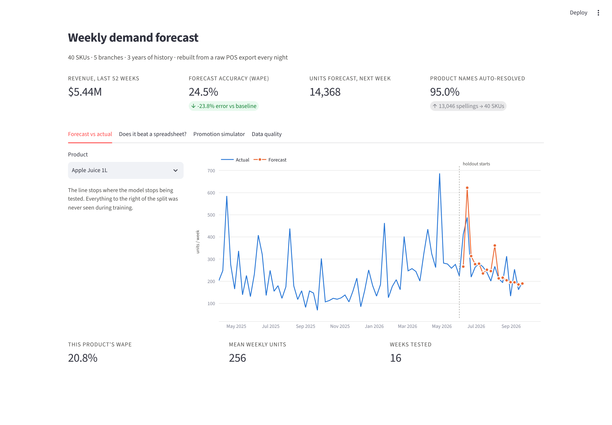

# Automated Sales Forecasting System

A raw point-of-sale export goes in at one end. A weekly demand forecast, a
dashboard, a prediction API and a Telegram bot come out the other — rebuilt
end to end by one command, every night.



---

## What it does

| Stage | What happens |
|---|---|
| **Ingest** | 63,500 raw transactions, three date formats, 25 spellings of five branch names |
| **Clean** | Duplicates dropped, dates parsed, branches normalised, prices and revenue repaired, returns separated |
| **Match** | 13,000 free-text product spellings resolved to 40 catalogue SKUs — 95% automatically, the rest to a human review queue |
| **Model** | Next-week demand per SKU, LightGBM, scored against three spreadsheet baselines on 16 held-out weeks |
| **Serve** | FastAPI prediction endpoint · Streamlit dashboard · Telegram bot with a Monday digest and stock alerts |

## Results, measured on 16 weeks the model never saw

| | WAPE | vs best baseline |
|---|---|---|
| **LightGBM, SKU level** | **24.5%** | **−23.8% error** |
| Baseline: 4-week average | 32.2% | — |
| Baseline: same week last year | 39.0% | — |
| Baseline: last week | 40.3% | — |

The branch × SKU model is reported too, at 49.6% WAPE against a 56.5%
baseline. Individual branch-level series are genuinely noisy and the report
says so rather than quietly showing only the flattering number.

**The finding worth paying for:** the strongest single input is not sales
history, it is the planned promotion calendar — 29.8% of the model's split
gain. Feeding it in is what moves the error from 32% to 25%. Most businesses
already keep that calendar in a spreadsheet and never connect it to anything.

---

## Run it

```bash
pip install -r requirements.txt
python run_pipeline.py          # generate → clean → train, about 60 seconds
```

Then any of:

```bash
streamlit run src/app.py                      # dashboard  → localhost:8501
uvicorn src.api:app --reload                  # API        → localhost:8000/docs
TELEGRAM_BOT_TOKEN=... python src/bot.py      # bot
```

With no token set, `src/bot.py` prints the digest it would have sent, so the
message format can be reviewed without a Telegram account.

### API

```bash
curl -X POST localhost:8000/forecast \
  -H 'Content-Type: application/json' \
  -d '{"sku": "SKU-1007", "planned_discount_pct": 25}'
```

```json
{
  "sku": "SKU-1007",
  "product_name": "Mineral Water Still 1.5L",
  "forecast_week": "2026-09-28",
  "forecast_units": 781.6,
  "recent_4w_average": 510.5,
  "planned_discount_pct": 25,
  "uplift_vs_recent_pct": 53.1
}
```

The caller supplies only what the model cannot know — which product, and what
the promotion plan says. Everything else is derived from stored history inside
the service.

Other endpoints: `GET /health`, `GET /model` (held-out scores and top
features), `POST /forecast/batch`, `GET /forecast/all`, `GET /catalogue`.

### Deploy

```bash
docker build -t forecast . && docker run -p 8000:8000 forecast
```

The image runs the full pipeline at build time, so the container starts with
data and model already in place. It deploys as-is to Railway, Render or
Fly.io. For a nightly rebuild, schedule `python run_pipeline.py` — cron,
GitHub Actions or the host's own scheduler.

---

## Layout

```
run_pipeline.py          one command: generate → clean → train
src/
  generate_data.py       synthetic source data, deliberately messy
  clean.py               parsing, normalisation, fuzzy matching, repairs
  features.py            lags, rolling windows, calendar, promotion drivers
  train.py               baselines, LightGBM, held-out evaluation
  api.py                 FastAPI prediction service
  app.py                 Streamlit dashboard
  bot.py                 Telegram bot and weekly digest
data/processed/          weekly fact table, review queue, quality report
models/                  trained models + evaluation.json
```

## Notes on method

**No leakage.** Every feature is knowable at the end of the current week.
The promotion features describe next week on purpose — the plan is set weeks
ahead, which is exactly what makes them valuable.

**Time-based split.** Train on the earlier weeks, score on the most recent
sixteen. A random split would flatter the model and answer a question nobody
asked.

**Baselines first.** A forecast is only worth paying for if it beats what the
client could already do in a spreadsheet, so three of those are scored on the
same rows with the same metric.

**Unmatched rows leave the pipeline.** 2,400 product spellings scored below
the auto-accept threshold. They go to `data/processed/match_review_queue.csv`
for a human, and are never guessed into the totals. A matching engine
reporting 100% is hiding its mistakes inside the numbers.

---

The data here is synthetic, generated by `src/generate_data.py`, so the whole
project is reproducible from scratch and contains no client information.
